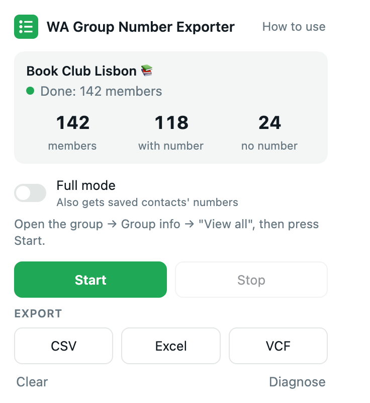
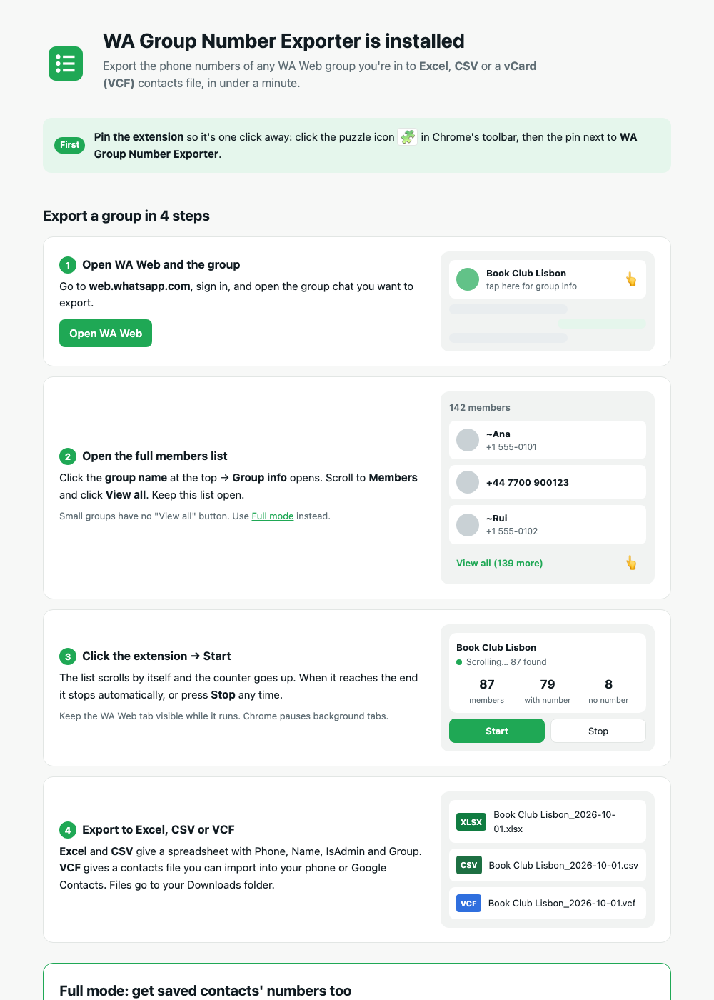

# WhatsApp Group Phone Numbers Downloader Exporter

**WA Group Number Exporter** is a free, open-source Chrome extension that
downloads the phone numbers and names of **WhatsApp Web group members**
(web.whatsapp.com) and exports them to **Excel (.xlsx)**, **CSV** or
**vCard (.vcf)**.

- No limits, no account and no payments
- Runs entirely in your browser, with no network requests at all
- MIT licensed

> This is an independent project. It is not affiliated with, endorsed or
> sponsored by WhatsApp LLC or Meta Platforms, Inc. WhatsApp is a trademark of
> WhatsApp LLC.

<p align="center">
  
</p>

## Features

- **Automatic scrolling:** scrolls the group's "View all" member list from top to bottom and collects every visible member.
- **Three export formats:**
  - **Excel (.xlsx):** cells stored as text, so numbers keep their leading `+`. Bold, frozen header row with filters.
  - **CSV:** UTF-8 with BOM, for Google Sheets, Numbers, LibreOffice and CRMs.
  - **vCard 3.0 (.vcf):** import everyone into Google Contacts, iPhone or Android.
- **Full mode:** also gets the numbers of members who are saved in your contacts. In the normal list those members appear by name only. Full mode needs no "View all" and finishes in about a second.
- **Clean data:**
  - international `+` format, duplicates removed, admins flagged
  - `~push names` cleaned up
  - right-to-left names and emoji supported
- **Welcome guide** that opens on install, with step-by-step instructions.
- **Diagnose report** for bug reports. It contains page structure only, never names or numbers.

## Step-by-step guide

### 1. Install the extension (about 2 minutes)

The extension isn't in the Chrome Web Store, so you install it from this page:

1. Go to [**Releases**](../../releases/latest) and download
   `wa-group-number-exporter-<version>.zip`.
   Or click the green **Code** button → **Download ZIP**.
2. **Unzip** the file. You get a folder that contains `manifest.json`.
   Keep this folder: Chrome loads the extension from it.
3. In Chrome, type `chrome://extensions` in the address bar and press Enter.
   - Brave: `brave://extensions`
   - Edge: `edge://extensions`
4. Turn on **Developer mode** with the switch in the top-right corner.
5. Click **Load unpacked** and select the unzipped folder, the one with
   `manifest.json` inside.
6. A welcome guide opens. **Pin the extension** so it's one click away: click
   the puzzle icon in the toolbar, then the pin next to
   **WA Group Number Exporter**.

If WhatsApp Web was already open, it works right away without a reload.

### 2. Export a group (under a minute)

1. Open [web.whatsapp.com](https://web.whatsapp.com), sign in, and open the
   group you want to export. You can only export groups you're a member of.
2. Click the **group name** at the top of the chat → **Group info** opens.
   Scroll to **Members** and click **View all**. Keep this list open.
3. Click the extension icon → **Start**. The member list scrolls by itself
   and the counter goes up. When it reaches the end it shows **Done**.
   You can press **Stop** at any time and keep what was collected.
4. Under **Export**, click:
   - **Excel**: an .xlsx spreadsheet, where numbers keep their `+`
   - **CSV**: for Google Sheets, CRMs and other tools
   - **VCF**: a contacts file for your phone

   The file goes to your **Downloads** folder as `<Group name>_<date>.<ext>`.

### 3. Full mode: include saved contacts

In the "View all" list, people **saved in your phone** appear by name only, so
their numbers aren't on screen. To include them:

1. Turn on **Full mode** in the extension popup.
2. Open the group chat. You don't need "View all".
3. Press **Start**. It finishes in about a second.

Also use Full mode for **small groups** that have no "View all" button.
Full mode reads WhatsApp Web's internal data, so a WhatsApp Web update can
break it. If that happens the extension tells you, and normal mode keeps
working.

### 4. Update or remove

- **Update:** download the new release, replace the folder's contents, then
  click the reload icon on the extension's card in `chrome://extensions`.
- **Remove:** click **Remove** on the extension's card. This also deletes any
  collected list.

<p align="center">
  
</p>

### Exported columns

| Column | Example | Notes |
|---|---|---|
| Phone | `+447700900123` | Empty for saved contacts in normal mode and for numbers WA Web hides |
| Name | `Ana Costa` | Display name, or your saved contact name. Empty if the member has none |
| IsAdmin | `yes` / `no` | |
| Group | `Book Club Lisbon` | |

### Importing the files

- **Excel:** open the .xlsx directly.
- **Google Sheets:** File → Import → Upload the CSV. Untick "Convert text to numbers, dates and formulas" to keep the `+`.
- **Google Contacts:** contacts.google.com → Import → choose the .vcf file.
- **iPhone:** AirDrop or email the .vcf to yourself → open it → *Add All Contacts*.
- **Android:** Contacts app → Settings → Import → choose the .vcf file.

## Privacy

- Member names and numbers are read from the WA Web page in your browser **only when you press Start**, and only for the open group.
- Data is kept in `chrome.storage.local` until you press **Clear**, start a new export or remove the extension.
- The extension makes **no network requests**: no servers, no analytics, no tracking. You can verify this in the source.
- It runs only on `https://web.whatsapp.com/*`. It doesn't read your messages and never sends anything on your behalf.

Permissions used:

| Permission | Why |
|---|---|
| `https://web.whatsapp.com/*` | Read the member list of the group you choose |
| `storage` | Keep the collected list while the popup is closed |
| `downloads` | Save the exported file |
| `scripting` | Start in WA Web tabs that were already open when the extension was installed |

## Limitations

- You can only export groups you are a member of.
- WA Web hides some members' numbers for privacy, for example in community announcement groups. Nothing can export those.
- Keep the WA Web tab visible while an export runs, because Chrome throttles background tabs.
- WA Web changes its page from time to time, which can break the selectors. See below.

## Troubleshooting

| Problem | Fix |
|---|---|
| "Open the group's View all members list first" | Open Group info → Members → View all, then press Start. No "View all" button? Use Full mode. |
| Members without a number | They're saved in your contacts. Use Full mode. |
| Count lower than the group size | Keep the tab visible and press Start again. Results are de-duplicated. |
| Broken after a WA Web update | Click **Diagnose** and attach the report to a [new issue](../../issues/new). |

## Development

There's no build step and no dependencies. You need Node 18+ for the tests and
Python 3 for the helper scripts.

```bash
npm test                         # unit tests (node --test)
bash tools/package.sh            # runs tests, builds dist/wa-group-number-exporter-<version>.zip
python3 tools/make_icons.py      # regenerates icons/
python3 tools/make_popup_preview.py  # regenerates tests/harness/popup-preview.html
```

```
manifest.json
src/background.js       welcome guide on install, injects into already-open WA Web tabs
src/content/            selectors.js (all DOM assumptions), parser.js, scraper.js, content.js
src/page/store-reader.js  Full mode (runs in the page's MAIN world)
src/lib/                phone, filename, CSV, VCF, XLSX + zip writer (pure, unit-tested)
src/popup/              popup UI
src/onboarding/         welcome guide
tests/                  unit tests
tests/harness/          browser harnesses: simulated members dialog, popup preview
tools/                  icons, popup preview, packaging
```

**Browser harnesses.** Run `python3 -m http.server 8765` in the repo root, then open:
- `http://localhost:8765/tests/harness/members-dialog.html?variant=listitem`
  (also `translateY` and `plain`). This simulates a 250-member virtualized list.
  Expected result: 249 total, 200 with phone, 49 without, 14 admins.
- `http://localhost:8765/tests/harness/popup-preview.html?state=done`
  (also `running`, `error`, `offsite`).

**When WA Web changes,** fixes almost always belong in
[`src/content/selectors.js`](src/content/selectors.js). Every DOM assumption
lives there, with several fallback strategies.

## Contributing

Issues and pull requests are welcome. Please include a Diagnose report for
selector bugs. Never include real names or phone numbers in issues, test data or
screenshots. Use fictional `555-01xx` or `+44 7700 900xxx` numbers.

## Use responsibly

Group members' phone numbers are personal data. Use exported contacts only for
purposes the members would expect, keep the files secure, and follow the privacy
laws that apply to you (for example the GDPR). Don't use this tool to send
unsolicited messages. Automated data collection may be against WA's Terms of
Service. You use this tool at your own risk.

## License

[MIT](LICENSE)
